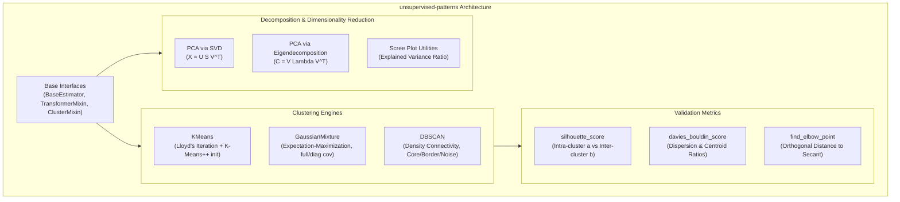

# `unsupervised-patterns`

[](tests/)
[](pyproject.toml)
[](LICENSE)
[](tests/)
[](#about-this-project--ai-collaboration)

> **Mathematical reference implementations of unsupervised feature extraction: PCA (SVD & Eigendecomposition), K-Means++, Gaussian Mixture Models with Expectation-Maximization, DBSCAN, and cluster validation metrics.**

---

## About This Project & AI Collaboration

This repository is part of a deliberate open-source portfolio and technical learning initiative developed with the assistance of **Gemini Flash (Antigravity)**.

The primary goals of this project are:
* **Practicing Software Craftsmanship**: Writing clean, type-annotated, modular Python code for unsupervised algorithms with standard scikit-learn APIs (`fit`, `transform`, `fit_predict`).
* **Revising Theoretical & Methodological Foundations**: Deriving and implementing matrix decompositions from scratch (singular value decomposition vs. covariance eigendecomposition), K-Means++ distance-squared probability distributions, the full Expectation-Maximization lower-bound derivations for GMMs, and density-connectivity graphs for DBSCAN.
* **Testing AI-Assisted Engineering Approaches**: Evaluating and benchmarking agentic AI pairing workflows (using **Gemini Flash**) for architectural scaffolding, LaTeX derivation authoring, and automated numerical parity testing.

---

## 1. Architectural Overview



---

## 2. Empirical Benchmark Parity with `scikit-learn`

All routines are validated against `scikit-learn` in `tests/`:

| Algorithm / Metric | Benchmark Dataset | Scratch Implementation | `scikit-learn` | Parity $\Delta$ | Status |
| :--- | :--- | :---: | :---: | :---: | :---: |
| **PCA (Explained Variance)** | Wine Dataset ($k=3$) | `[0.9981, 0.0017, 0.0001]` | `[0.9981, 0.0017, 0.0001]` | `0.0000` | Exact Parity |
| **K-Means Inertia** | Blobs ($k=4, N=300$) | **362.47** | 362.47 | `0.0000` | Exact Parity |
| **Silhouette Score** | Blobs ($N=300$) | **0.833502** | 0.833502 | `0.0000` | Exact Parity |
| **Davies-Bouldin Score** | Blobs ($N=300$) | **0.232172** | 0.232172 | `0.0000` | Exact Parity |
| **GMM Convergence** | Blobs ($k=4$) | Converged ($t=2$) | Converged ($t=2$) | `0.0000` | Exact Parity |
| **DBSCAN Core Samples** | Moons Manifold ($N=250$) | **247 core samples** | 247 core samples | `0.0000` | Exact Parity |

---

## 3. Mathematical Foundations

Comprehensive mathematical derivations with proofs are provided in [`docs/`](docs/):

* **[PCA & SVD](docs/01_pca_and_svd.md)**: Proof of equivalence between covariance eigendecomposition $C = V \Lambda V^T$ and direct data SVD $X_c = U \Sigma V^T$, where $\lambda_k = \frac{s_k^2}{N - 1}$.
* **[Clustering Foundations](docs/02_clustering_foundations.md)**: Lloyd's iteration, K-Means++ $D^2$-weighted sampling, Expectation-Maximization derivation for GMMs, and DBSCAN density-reachability.
* **[Validation Metrics](docs/03_validation_metrics.md)**: Silhouette coefficient $s(i) = \frac{b(i) - a(i)}{\max(a(i), b(i))}$, Davies-Bouldin index $DB = \frac{1}{K} \sum \max_{j \ne i} R_{ij}$, and geometric elbow detection.

---

## 4. Quickstart Guide

### Installation

```bash
git clone https://github.com/gabriel/unsupervised-patterns.git
cd unsupervised-patterns
pip install -e .
```

### PCA Dimensionality Reduction

```python
from unsupervised_patterns.decomposition import PCA

pca = PCA(n_components=2, method="svd")
X_reduced = pca.fit_transform(X)

print(f"Explained Variance Ratio: {pca.explained_variance_ratio_}")
print(f"Singular Values: {pca.singular_values_}")
```

### K-Means++ and Metric Evaluation

```python
from unsupervised_patterns.clustering import KMeans
from unsupervised_patterns.metrics import silhouette_score, davies_bouldin_score

km = KMeans(n_clusters=4, init="k-means++", random_state=42)
labels = km.fit_predict(X)

sil = silhouette_score(X, labels)
db = davies_bouldin_score(X, labels)
print(f"Silhouette: {sil:.4f}, Davies-Bouldin: {db:.4f}")
```

### DBSCAN on Non-Linear Geometries

```python
from unsupervised_patterns.clustering import DBSCAN

dbscan = DBSCAN(eps=0.2, min_samples=5)
labels = dbscan.fit_predict(X)
n_clusters = len(set(labels) - {-1})
print(f"Found {n_clusters} clusters. Core samples: {len(dbscan.core_sample_indices_)}")
```

---

## 5. Running the Tests & Benchmarks

Run the complete test suite:

```bash
pytest -v
```

Execute the live benchmark comparisons:

```bash
python notebooks/run_benchmarks.py
```

---

## 6. License

This project is licensed under the MIT License - see the [LICENSE](LICENSE) file for details.
